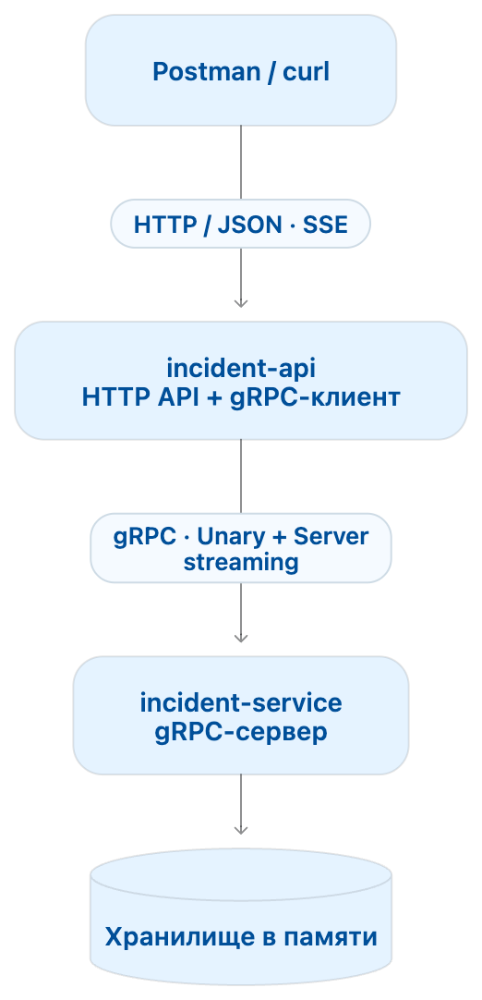

## Домашнее задание №6. gRPC и управление инцидентами

### Техническая информация

| Параметр | Значение |
| :---- | :---- |
| Количество попыток | не ограничено |
| Оценивание | 0–10, по критериям ниже |
| Проверяющий | преподаватель и автоматические проверки |
| Дедлайн | объявляется преподавателем |

## Цель задания

Спроектировать protobuf-контракт, связать два приложения через gRPC, реализовать server streaming и интерсепторы.

## Условие

За основу возьмём идею [Rootly](https://www.ycombinator.com/companies/rootly) - сервиса для координации работы во время технических сбоев.

Допустим, в интернет-магазине перестала работать оплата. Дежурный создаёт инцидент, назначает ответственного и публикует обновления. Остальные участники следят за ходом исправления.

В задании два приложения на Go. HTTP-слой уже написан; ваша задача — связать приложения по gRPC и реализовать работу с инцидентами:

- `incident-service` - gRPC-сервис с бизнес-логикой и хранением данных;
- `incident-api` — готовый HTTP API; в нём нужно реализовать адаптер gRPC-клиента.



Оба приложения находятся в одном репозитории и используют один `go.mod`, но запускаются отдельными процессами из `cmd/incident-api` и `cmd/incident-service`. По умолчанию HTTP API слушает `localhost:8080`, gRPC-сервис — `localhost:50051`; HTTP API подключается к нему по сети, а не вызывает бизнес-логику напрямую. Данные хранятся в памяти `incident-service`. После перезапуска они могут исчезать.

## Что уже готово

- `internal/transport/http/` — маршруты, разбор JSON, HTTP-ошибки, SSE, request ID и таймауты unary-запросов.
- `internal/contract/` — обычные Go-типы снимка и комментария, а также ошибка адаптера. Они не зависят от protobuf.
- `internal/requestid/` — сохранение и чтение request ID из контекста.
- `cmd/incident-api/main.go` — запуск HTTP-сервера, флаги адресов и корректная остановка.
- `apitest/` — проверки всей цепочки через HTTP и входные данные.

Эти пакеты и готовые проверки не изменяйте. Если меняете module path, разрешено обновить пути импортов.

## Что нужно написать

1. Protobuf-контракт и генерацию кода.
2. Бизнес-логику, хранение и подписки в `incident-service`.
3. gRPC-обработчики и запуск `cmd/incident-service`.
4. Адаптер в `internal/client/incident/client.go` вместо заглушек.
5. Клиентские и серверные gRPC-интерсепторы, метрики и собственные тесты.

HTTP-хендлеры работают через интерфейсы `httpapi.Client` и `httpapi.Stream`, описанные в `internal/transport/http/handler.go`. Адаптер должен реализовать их, вызывая сгенерированный gRPC-клиент. Возвращайте `contract.Incident` и преобразуйте ошибки gRPC в `*contract.Error`: поле `Code` содержит имя кода, поле `Message` — безопасное сообщение. Не передавайте внутренние подробности ошибок пользователю.

`Watch` возвращает обёртку над gRPC-потоком. Её `Recv` преобразует protobuf-снимок в `contract.Incident`, возвращает `io.EOF` при штатном завершении и преобразует gRPC-ошибки. Передавайте контекст в реальный gRPC-вызов: отмена должна прерывать заблокированный `Recv`.

Request ID для клиентских интерсепторов доступен через `requestid.FromContext(ctx)`. Таймаут unary-запроса уже установлен HTTP-хендлером — не теряйте этот контекст. Валидация названий, статусов и переходов остаётся на стороне gRPC-сервиса.

В заготовке `incident.New` ещё не открывает соединение, а методы возвращают `Unavailable`. Поэтому HTTP API уже запускается, но отвечает `503`, пока вы не реализуете адаптер. Подключение создавайте в `New`, освобождение ресурсов — в `Close`.

## Возможности сервиса

Пользователь может создать инцидент, назначить ответственного, изменить статус, добавить комментарий и подписаться на обновления.

У инцидента есть:

- ID;
- название;
- затронутый сервис, например `payments`;
- статус;
- ответственный — сначала может отсутствовать;
- список комментариев;
- версия состояния.

У комментария есть автор, текст и время создания. Регистрация и авторизация не нужны: имена участников передаются в запросах.

## Правила работы

Статусы меняются последовательно:

```text
OPEN → INVESTIGATING → RESOLVED
```

- Новый инцидент получает статус `OPEN` и версию `1`.
- Начать расследование можно только после назначения ответственного.
- Пропускать статусы и возвращаться назад нельзя.
- Повторная установка текущего статуса завершается успешно, но не меняет версию.
- Повторное назначение того же ответственного также ничего не меняет.
- После закрытия инцидент доступен только для чтения. Единственное исключение — повторная установка `RESOLVED`. Назначение ответственного после закрытия запрещено, даже если имя не меняется.
- Каждое фактическое изменение увеличивает версию на единицу.
- Одинаковые названия инцидентов разрешены.

Новая запись получает версию `1`, пустого ответственного и пустой массив комментариев. Длина строк считается в Unicode-символах, а не байтах. Нормализованные значения сохраняются без пробелов по краям.

Проверяйте поля после удаления пробелов по краям:

- название — от 1 до 200 символов;
- комментарий — от 1 до 1000 символов;
- имя сервиса, автора и ответственного не может быть пустым.

Параллельные запросы не должны терять данные. Например, два одновременно добавленных комментария должны сохраниться оба.

## gRPC-сервис

Самостоятельно опишите protobuf-контракт и сгенерируйте Go-код. Используйте `package incident.v1` и задайте `go_package`.

| Метод | Тип RPC | Назначение |
|---|---|---|
| `CreateIncident` | Unary | Создать инцидент |
| `GetIncident` | Unary | Получить состояние |
| `AssignIncident` | Unary | Назначить ответственного |
| `ChangeStatus` | Unary | Изменить статус |
| `AddComment` | Unary | Добавить комментарий |
| `WatchIncident` | Server streaming | Получать обновления |

Для каждого метода нужны собственные сообщения запроса и ответа.

Возвращайте следующие коды ошибок:

| Ситуация | gRPC-код |
|---|---|
| Некорректные поля | `InvalidArgument` |
| Инцидент не найден | `NotFound` |
| Недопустимый переход или изменение закрытого инцидента | `FailedPrecondition` |
| Непредвиденная ошибка сервера | `Internal` |

## Подписка на инцидент

`WatchIncident` сразу отправляет текущее состояние, затем — новые снимки после изменений. В снимок входят все поля инцидента, включая комментарии и версию.

Требования:

- На один инцидент могут подписаться несколько клиентов.
- Версии у подписчика должны строго возрастать; повторные снимки без изменения версии не отправляйте.
- Медленный подписчик не блокирует изменение данных и остальных участников.
- Разрешается пропускать промежуточные снимки, оставляя для отправки самый свежий.
- При отключении клиента подписка удаляется, связанные ресурсы освобождаются.
- При закрытии инцидента подписчики получают финальный снимок, после чего поток завершается.
- Подписка на уже закрытый инцидент отправляет один снимок и завершается.

Не удерживайте блокировку хранилища во время сетевой отправки. Восстановление пропущенных обновлений после переподключения не требуется: клиент снова получает актуальный снимок.

## HTTP API

HTTP-сервис не хранит инциденты и не дублирует бизнес-правила. Он разбирает запрос, вызывает gRPC-метод и преобразует результат в HTTP-ответ.

| Маршрут | gRPC-метод | Успешный HTTP-код |
|---|---|---|
| `POST /incidents` | `CreateIncident` | `201` |
| `GET /incidents/{id}` | `GetIncident` | `200` |
| `PUT /incidents/{id}/assignee` | `AssignIncident` | `200` |
| `PUT /incidents/{id}/status` | `ChangeStatus` | `200` |
| `POST /incidents/{id}/comments` | `AddComment` | `200` |
| `GET /incidents/{id}/events` | `WatchIncident` | `200`, SSE |

Примеры тел запросов:

```json
{"title": "Не проходят платежи", "service": "payments"}
```

```json
{"user": "Nick"}
```

```json
{"status": "INVESTIGATING"}
```

```json
{"author": "Nick", "text": "Проверяю платёжного провайдера"}
```

Unary-методы возвращают снимок напрямую, без обёртки `incident`. Формат HTTP JSON фиксирован для проверки; protobuf-сообщения спроектируйте самостоятельно:

```json
{
  "id": "непустой ID, назначенный сервером",
  "title": "Не проходят платежи",
  "service": "payments",
  "status": "OPEN",
  "assignee": "",
  "comments": [],
  "version": 1
}
```

Комментарий имеет поля `author`, `text`, `created_at`. Время — строка RFC3339 с часовым поясом. Комментарии идут в порядке добавления; `comments` всегда массив, включая пустой. Версия — JSON-число. Статусы передаются строками `OPEN`, `INVESTIGATING`, `RESOLVED`; неизвестный статус даёт `400`. ID непрозрачный: формат выбирает студент. Ошибка не меняет состояние и версию. При ошибочном поле и неизвестном ID сначала проверяйте поля, затем наличие инцидента, затем бизнес-правила. Возвращайте `Content-Type: application/json` для JSON-ответов.

Ошибки возвращайте в едином формате, например:

```json
{"error": "incident not found", "request_id": "..."}
```

Преобразование кодов:

| gRPC | HTTP |
|---|---|
| `InvalidArgument` | `400` |
| `NotFound` | `404` |
| `FailedPrecondition` | `409` |
| `Unavailable` | `503` |
| `DeadlineExceeded` | `504` |
| Остальные ошибки | `500` |

В теле ожидается один JSON-объект; некорректный JSON, `null`, массив и несовместимый тип поля возвращают `400`. Лимит тела — 1 МиБ. Неизвестные поля игнорируются. Стандартные ответы маршрутизатора для неизвестного пути или HTTP-метода не входят в проверяемый JSON-контракт. Внутренние подробности неожиданных ошибок оставляйте в логах.

## Передача обновлений через SSE

Маршрут `/incidents/{id}/events` открывает gRPC-подписку и передаёт снимки HTTP-клиенту:

```text
event: snapshot
data: {"id":"...","status":"INVESTIGATING","version":3,...}

```

Готовый SSE-хендлер устанавливает `Content-Type: text/event-stream` и сразу отправляет каждое событие. Время одной сетевой записи ограничено пятью секундами: при зависшей записи HTTP-подписка отменяется.

До отправки HTTP-заголовков получите первый снимок из gRPC-потока. Это позволит вернуть обычный `404`, если инцидент не существует.

Если ошибка произошла после начала SSE-ответа, отправьте событие `error` и закройте соединение. При штатном завершении gRPC-потока просто завершите HTTP-ответ.

Отключение HTTP-клиента должно отменять gRPC-подписку. Для проверки достаточно:

```text
curl -N http://localhost:8080/incidents/INCIDENT_ID/events
```

## Соединения и контекст

В `incident.New` создайте одно переиспользуемое gRPC-соединение на процесс; используйте его во всех методах адаптера.

Готовый HTTP-слой задаёт unary-таймаут (по умолчанию три секунды, флаг `-unary-timeout`). Контекст исходящего вызова должен быть связан с контекстом HTTP-запроса.

Для подписки используйте отдельный контекст без короткого unary-таймаута. Остановка любого приложения должна завершать его работу за ограниченное время, в том числе при открытых подписках.

## Логирование и интерсепторы

Готовый HTTP middleware принимает `X-Request-ID` или создаёт его, если заголовок отсутствует. Возвращайте идентификатор в заголовке HTTP-ответа.

Клиентские unary и stream interceptors передают его в gRPC metadata как `x-request-id`.

На стороне `incident-service` добавьте unary и stream interceptors, которые выводят:

```text
request_id=... method=... code=OK duration_ms=...
```

Собирайте в памяти по каждому RPC-методу:

- количество завершённых вызовов;
- количество завершений с кодом, отличным от `OK`;
- суммарную длительность.

Выводите статистику в stdout раз в 10 секунд. Обеспечьте безопасный конкурентный доступ.

Для streaming длительность — всё время жизни подписки. Пока поток открыт, он не считается завершённым вызовом.

## Структура проекта

```text
.
├── api/incident/v1/
│   └── incident.proto
├── gen/incident/v1/
│   ├── incident.pb.go
│   └── incident_grpc.pb.go
├── cmd/
│   ├── incident-api/main.go
│   └── incident-service/main.go
├── internal/
│   ├── contract/
│   │   └── contract.go          # Готовые типы и ошибка адаптера
│   ├── requestid/
│   │   └── requestid.go         # Готовый доступ к request ID
│   ├── incident/
│   │   ├── model.go
│   │   ├── service.go
│   │   └── subscription.go
│   ├── client/incident/
│   │   └── client.go
│   ├── transport/
│   │   ├── http/
│   │   │   ├── handler.go
│   │   │   └── sse.go
│   │   └── grpc/
│   │       └── server.go
│   └── interceptor/
│       ├── client.go
│       ├── logging.go
│       └── metrics.go
├── go.mod
├── go.sum
├── Makefile
└── readme.md
```

В `cmd` оставьте настройку, сборку зависимостей и запуск. В `internal/incident` разместите бизнес-логику и хранение без зависимости от HTTP и protobuf.

Транспортные пакеты отвечают за преобразование запросов, ответов и ошибок. Зависимости передавайте через конструкторы. Тесты располагайте рядом с кодом.

Папки `api/`, `gen/`, `internal/incident/`, `internal/transport/grpc/` и `internal/interceptor/` создайте при реализации. Готовые пакеты `internal/contract/`, `internal/requestid/` и `internal/transport/http/` сохраните. Дерево выше показывает основные части итогового решения, а не полный список файлов заготовки.

Для HTTP достаточно стандартного `net/http`. База данных, брокер, DI-фреймворк и gRPC Gateway в основной части не нужны.

## Тесты

Проверьте:

- валидацию и переходы статусов;
- запрет изменений после закрытия;
- конкурентное добавление комментариев;
- gRPC-коды ошибок и их преобразование адаптером в `contract.Error`;
- первый снимок и последующее обновление подписки;
- завершение подписки при отмене контекста;
- финальный снимок при закрытии инцидента;
- передачу `request_id` от HTTP до gRPC-сервера.

Для собственных gRPC-тестов можно использовать `bufconn`. Готовые HTTP-хендлеры уже проверены через `httptest`. Перед сдачей запустите:

```text
go test -race ./...
```

## Готовые данные и проверка

В `apitest/testdata/scenarios.json` лежат входные запросы и ожидаемые результаты. Сценарии, которым нужен существующий инцидент, создают его сами; проверки не зависят от заранее загруженных записей. `{id}` в маршруте заменяется ID из ответа создания. `expected` задаёт проверяемую часть снимка, остальные поля могут присутствовать. `comments_count` задаёт ожидаемое число комментариев. Готовые проверки читают этот файл; это не данные для загрузки в сервер при старте.

В двух терминалах запустите приложения с детектором гонок:

```sh
go run -race ./cmd/incident-service
go run -race ./cmd/incident-api
```

В третьем терминале из `homework-06`:

```sh
go test -race ./...
go test -race -tags=integration -count=1 -timeout=90s ./apitest
```

Первый запуск проверяет готовые HTTP-хендлеры с тестовым клиентом и ваши unit-тесты. Зелёные тесты хендлеров не означают, что gRPC уже реализован. Второй обращается к работающему HTTP API и проверяет сценарии, параллельные комментарии, передачу request ID в HTTP-ответе и SSE: первый снимок, двух наблюдателей, отключение одного и финальный снимок с завершением потока. Если API не запущено, проверки падают с ошибкой подключения. Для другого адреса задайте `INCIDENT_API_URL`.

`-race` у процесса тестов не проверяет память отдельно запущенных серверов, поэтому оба приложения также запускаются с `-race`.

Не изменяйте `apitest/` и данные в нём. Эти проверки не заменяют собственные тесты gRPC-кодов, отмены контекста, метрик и интерсепторов. Связь HTTP → gRPC, прохождение request ID через metadata, очистка подписок и отсутствие блокировки на медленном клиенте проверяются собственными тестами и при разборе кода. Не подменяйте gRPC прямым вызовом Go-функций.

Для ручной проверки можно брать тела запросов из JSON-файла. Для неизвестного инцидента используйте ID `missing-incident`. Дополнительно проверьте ответ `503` при остановленном gRPC-сервисе и найдите запрос по одному request ID в логах обоих приложений.

## Критерии проверки

| Часть | Баллы |
| :---- | :---- |
| Protobuf-контракт, генерация, рабочая связь HTTP → gRPC | 2 |
| Бизнес-правила, валидация, версии и ошибки | 2 |
| gRPC-подписки, адаптер потока, отмена и конкурентный доступ | 3 |
| Клиентские и серверные интерсепторы, request ID, статистика | 2 |
| Собственные тесты и воспроизводимый запуск | 1 |

Прохождение готовых HTTP-тестов само по себе не гарантирует максимальную оценку. Необходимо выполнить требования к gRPC и показать отсутствие гонок в обоих приложениях.

## Что и как сдавать

Отправьте ссылку на приватный git-репозиторий с доступом для проверяющих и папкой `homework-06`.

Включите исходники, `.proto`, сгенерированные файлы, `go.mod`, `go.sum` и собственные тесты. 

## Быстрый старт с заготовкой

```sh
# HTTP API запускается даже до реализации gRPC-клиента:
go run ./cmd/incident-api -http-addr localhost:8080 -grpc-addr localhost:50051 -unary-timeout 3s
```

```sh
# Пока адаптер не реализован, ожидается 503:
curl -i http://localhost:8080/incidents/example
```

Точка входа `cmd/incident-service` пока содержит только TODO и не запускает сервер. Генерация станет доступна после создания `.proto` и установки генераторов; это ожидаемое состояние заготовки. `go.sum` появится после добавления зависимостей.

Не устраняйте этот ответ правками HTTP-хендлеров: реализуйте TODO в gRPC-клиенте и запустите `incident-service`.
